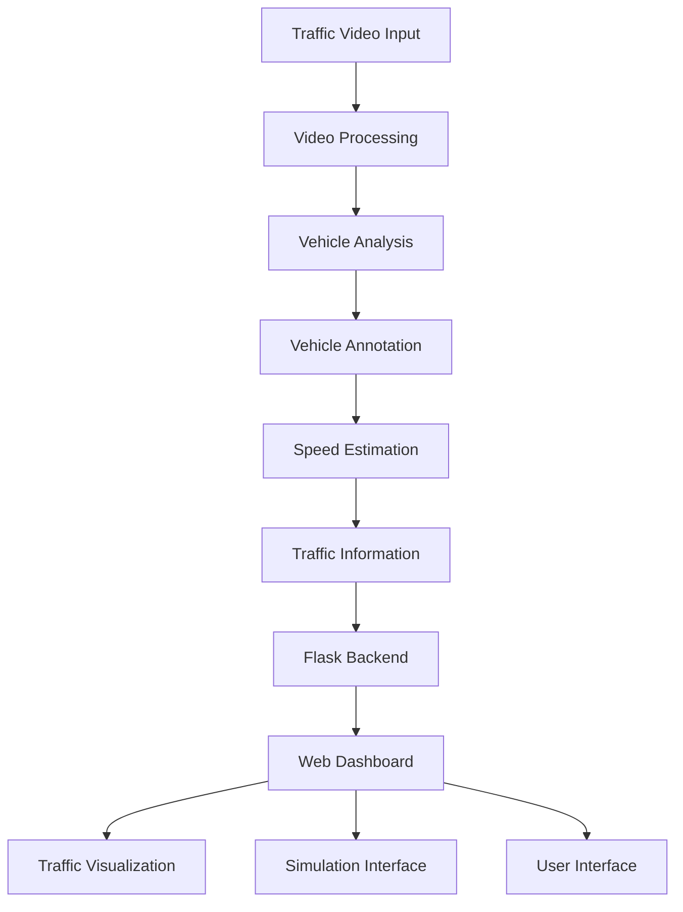

# 🚦 SMART CITY TRAFFIC MANAGEMENT SYSTEM – PHASE 2

<div align="center">

# 🏙️ Smarter Cities. Safer Roads. Faster Journeys.

### An Intelligent Traffic Monitoring and Management Solution


**Transforming traditional traffic monitoring into intelligent, data-driven urban mobility.**

[🚀 Explore Repository](https://github.com/meghanagowda75/Smart-City-Traffic-Management-System-Phase-2) • [🐛 Report an Issue](https://github.com/meghanagowda75/Smart-City-Traffic-Management-System-Phase-2/issues)

</div>

---

## 🌟 1. Project Overview

The **Smart City Traffic Management System – Phase 2** is an intelligent traffic monitoring and management application designed to support smarter urban transportation.

With increasing urbanization and the growing number of vehicles on roads, conventional traffic management approaches face challenges such as traffic congestion, inefficient monitoring, and delayed responses to emergency situations.

This project explores the use of computer vision, Python-based processing, and web technologies to make traffic monitoring more intelligent and efficient.

The system incorporates vehicle analysis, traffic visualization, and an interactive web interface to support traffic monitoring and management.

## 🎯 2. Project Objectives

- Develop an intelligent traffic monitoring system.
- Analyze vehicle movement and traffic conditions using computer vision.
- Estimate vehicle speed using video-based processing.
- Provide a user-friendly dashboard for traffic visualization.
- Explore intelligent approaches for identifying emergency vehicles.
- Improve traffic monitoring and support efficient urban transportation management.

## ✨ 3. Key Features

### 🚗 Vehicle Monitoring
- Video-based traffic monitoring.
- Vehicle identification and analysis.
- Visual representation of traffic activity.

### 📊 Traffic Analytics
- Traffic-related data processing.
- Vehicle speed estimation.
- Traffic monitoring and visualization.

### 🚨 Emergency Vehicle Detection
- Focus on identifying emergency vehicles.
- Support for emergency-aware traffic management.
- Potential to improve emergency response coordination.

### 🌐 Interactive Web Application
- Flask-based web application.
- User login and registration interfaces.
- Interactive dashboard.
- Simulation interface.
- Organized web templates.

### 🎥 Video Processing
- Video annotation.
- Perspective and view transformation.
- Speed estimation using dedicated processing modules.

## 🛠️ 4. Technology Stack

| Technology | Purpose |
|---|---|
| Python | Core programming language |
| Flask | Backend web framework |
| OpenCV | Computer vision and video processing |
| HTML5 | Web page structure |
| CSS3 | Styling and interface design |
| JavaScript | Frontend interactions |
| NumPy | Numerical operations |
| Git & GitHub | Version control and project hosting |

## 🏗️ 5. System Architecture

The system follows a modular architecture that connects video processing, traffic analysis, and web-based visualization.



## 📂 6. Project Structure

```text
Smart-City-Traffic-Management-System-Phase-2/
│
├── SCTMS-2/
│   └── project/
│       ├── src/
│       │   ├── __init__.py
│       │   ├── annotator.py
│       │   ├── speed_estimator.py
│       │   └── view_transformer.py
│       │
│       ├── templates/
│       │   ├── dashboard.html
│       │   ├── launch.html
│       │   ├── login.html
│       │   ├── signup.html
│       │   └── simulation.html
│       │
│       ├── app.py
│       ├── main.py
│       ├── config.py
│       ├── requirements.txt
│       ├── README.md
│       └── LICENSE
│
├── project/
│   └── Additional project files
│
└── README.md
```

## ⚙️ 7. Installation and Setup

Follow these steps to run the project locally.

### Prerequisites

- Python 3.10 or above
- pip package manager
- Git
- VS Code or any Python-supported IDE

### Step 1: Clone the Repository

```bash
git clone https://github.com/meghanagowda75/Smart-City-Traffic-Management-System-Phase-2.git
```

### Step 2: Navigate to the Project

```bash
cd Smart-City-Traffic-Management-System-Phase-2
cd SCTMS-2/project
```

### Step 3: Create a Virtual Environment

```bash
python -m venv venv
```

Activate it on Windows:

```bash
venv\Scripts\activate
```

### Step 4: Install Dependencies

```bash
pip install -r requirements.txt
```

### Step 5: Run the Application

```bash
python app.py
```

If the application uses `main.py` as its entry point, run:

```bash
python main.py
```

Open the local URL displayed in your terminal to access the application.

## 🎬 8. Project Demonstration

<div align="center">

# ▶️ SEE THE SYSTEM IN ACTION

**Watch the complete demonstration of the Smart City Traffic Management System – Phase 2.**

</div>

<!-- Replace the placeholder below with your actual GitHub-uploaded video attachment URL. -->

**Project Demo Video:**

[PASTE YOUR GITHUB VIDEO ATTACHMENT URL HERE]

The demonstration showcases the application interface, traffic monitoring workflow, video processing, and implemented project functionalities.

## 📸 9. Application Screenshots

Add your actual project screenshots here to showcase the application.

| Module | Screenshot |
|---|---|
| Login Page | Add login screenshot |
| Signup Page | Add signup screenshot |
| Dashboard | Add dashboard screenshot |
| Traffic Simulation | Add simulation screenshot |
| Traffic Analysis | Add analysis screenshot |

Example:

```markdown

```

## 🔮 10. Future Enhancements

- Integration with real-time CCTV traffic feeds.
- Advanced AI-based vehicle classification.
- Improved emergency vehicle recognition.
- Adaptive traffic signal management.
- Integration with IoT-based traffic sensors.
- Cloud-based traffic monitoring and analytics.
- Real-time traffic congestion prediction.
- Smart city infrastructure integration.

## 🌍 11. Applications

- Smart city infrastructure.
- Urban traffic monitoring.
- Intelligent transportation systems.
- Emergency response management.
- Traffic analysis and research.
- Road safety monitoring.

## 👩‍💻 12. Development

This project is developed as an initiative towards exploring intelligent transportation systems and applying computer vision and web technologies to real-world urban traffic management challenges.

## 🤝 13. Contributing

Contributions and suggestions are welcome!

1. Fork this repository.
2. Create a new branch.
3. Implement your changes.
4. Commit your changes.
5. Submit a pull request.

## 📜 14. License

This project is licensed under the MIT License.

See the [LICENSE](LICENSE) file for more details.

---

<div align="center">

## ⭐ SUPPORT THE PROJECT

If you find this project interesting, consider giving this repository a ⭐ on GitHub!

**Building intelligent transportation systems for smarter cities and safer roads.**

### 🚦 SMART CITY TRAFFIC MANAGEMENT SYSTEM – PHASE 2

**Designed for a smarter tomorrow.**

</div>

---

<div align="center">

Made with ❤️ using Python, Computer Vision and Web Technologies.

</div>
