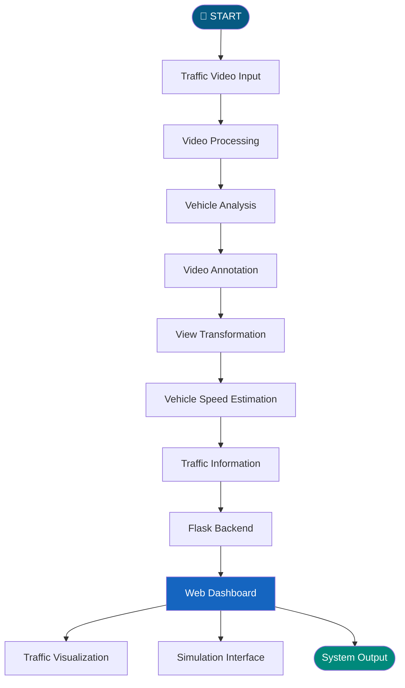
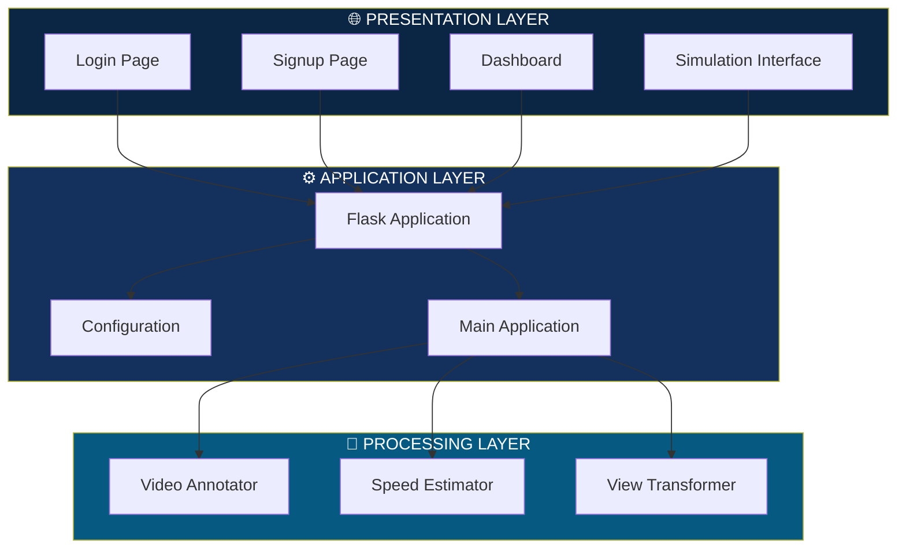

# 🚦 URBANFLOW | SMART CITY TRAFFIC MANAGEMENT SYSTEM

<div align="center">


### 🏙️ Reimagining Urban Mobility Through Intelligent Traffic Management

**A computer vision-powered traffic monitoring and analysis application designed to explore smarter, safer, and more efficient urban transportation.**

<br/>

<a href="https://github.com/meghanagowda75/Smart-City-Traffic-Management-System-Phase-2">

</a>


<br/><br/>

**PHASE 02 | INTELLIGENT TRANSPORTATION | COMPUTER VISION**

</div>

---

# 🌐 01. THE VISION

> What if cities could understand their traffic instead of simply watching it?

Urban traffic congestion, inefficient vehicle monitoring, and delayed emergency responses are major challenges in modern cities.

**UrbanFlow – Smart City Traffic Management System** explores an intelligent approach to traffic monitoring by combining computer vision, video processing, vehicle analysis, and web technologies.

The application provides a platform for processing traffic videos, estimating vehicle speeds, visualizing traffic-related information, and exploring intelligent traffic management.

Our vision is to move towards a future where traffic systems become more connected, responsive, and data-driven.

---

# ⚡ 02. EXPLORE THE SYSTEM

<div align="center">

| 🚗 VEHICLE ANALYSIS | 🎥 VIDEO PROCESSING |
|:---:|:---:|
| Traffic video analysis | Video annotation |
| Vehicle monitoring | View transformation |

| 📊 TRAFFIC INTELLIGENCE | 🌐 WEB DASHBOARD |
|:---:|:---:|
| Speed estimation | Interactive interface |
| Traffic visualization | User management |

</div>

## ✨ Core Capabilities

<details>
<summary><b>🚗 Vehicle Monitoring and Analysis</b></summary>

- Analyze traffic video input.
- Process vehicle-related information.
- Support visual monitoring of road activity.
- Explore vehicle movement patterns.

</details>

<details>
<summary><b>🎥 Computer Vision and Video Processing</b></summary>

- Video processing using OpenCV.
- Video annotation.
- Perspective and view transformation.
- Vehicle speed estimation modules.

</details>

<details>
<summary><b>📊 Traffic Analytics</b></summary>

- Process traffic-related information.
- Estimate vehicle speed.
- Support traffic visualization.
- Provide an interface for monitoring analysis results.

</details>

<details>
<summary><b>🚨 Emergency Vehicle Management</b></summary>

The project explores emergency vehicle detection as part of intelligent traffic management, with the goal of supporting faster emergency response and improved road coordination.

</details>

<details>
<summary><b>🌐 Web Application</b></summary>

- Flask-powered backend.
- Login and registration pages.
- Interactive dashboard.
- Simulation interface.
- Organized HTML templates.

</details>

---

# 🧠 03. HOW THE SYSTEM WORKS

<div align="center">

### SYSTEM WORKFLOW

</div>



### 🔄 Processing Pipeline

| Stage | Operation | Purpose |
|---|---|---|
| 01 | Video Input | Accept traffic video |
| 02 | Video Processing | Process video frames |
| 03 | Vehicle Analysis | Analyze vehicle activity |
| 04 | Annotation | Visualize processed information |
| 05 | View Transformation | Handle perspective transformation |
| 06 | Speed Estimation | Estimate vehicle speed |
| 07 | Visualization | Display information through the application |

---

# 🖥️ 04. INTERACTIVE SYSTEM EXPERIENCE

<div align="center">

### EXPLORE THE APPLICATION MODULES

</div>

<details>
<summary><b>🔐 MODULE 01 — USER AUTHENTICATION</b></summary>

The authentication interface provides user login and registration pages.

**Components:**
- Login interface.
- Signup interface.
- User-facing navigation.

</details>

<details>
<summary><b>📊 MODULE 02 — TRAFFIC DASHBOARD</b></summary>

The dashboard serves as the main interface for accessing the application's traffic monitoring functionality.

**Components:**
- Dashboard interface.
- Traffic-related information.
- Access to application modules.

</details>

<details>
<summary><b>🎬 MODULE 03 — TRAFFIC SIMULATION</b></summary>

The simulation interface provides access to the traffic simulation workflow.

**Components:**
- Simulation page.
- Video-based processing workflow.
- Traffic analysis interface.

</details>

<details>
<summary><b>⚙️ MODULE 04 — VIDEO ANALYSIS ENGINE</b></summary>

The Python processing modules handle different video-analysis operations.

**Components:**
- Annotator.
- Speed estimator.
- View transformer.

</details>

---

# 🏗️ 05. SYSTEM ARCHITECTURE



---

# 🛠️ 06. TECHNOLOGY ECOSYSTEM

<div align="center">

| TECHNOLOGY | ROLE |
|:---:|---|
| 🐍 **Python** | Core application logic |
| 🌶️ **Flask** | Backend web framework |
| 👁️ **OpenCV** | Computer vision and video processing |
| 🌐 **HTML5** | Web structure |
| 🎨 **CSS3** | Interface styling |
| ⚡ **JavaScript** | Frontend interactions |
| 🔢 **NumPy** | Numerical processing |
| 🐙 **Git & GitHub** | Version control |

</div>

---

# 📁 07. PROJECT STRUCTURE

```text
Smart-City-Traffic-Management-System-Phase-2/
│
├── SCTMS-2/
│   └── project/
│       │
│       ├── src/
│       │   ├── __init__.py
│       │   ├── annotator.py
│       │   ├── speed_estimator.py
│       │   └── view_transformer.py
│       │
│       ├── templates/
│       │   ├── dashboard.html
│       │   ├── launch.html
│       │   ├── login.html
│       │   ├── signup.html
│       │   └── simulation.html
│       │
│       ├── app.py
│       ├── main.py
│       ├── config.py
│       ├── requirements.txt
│       ├── README.md
│       └── LICENSE
│
├── project/
│   └── Additional project files
│
└── README.md
```

---

# 🚀 08. GET STARTED

### Prerequisites

Make sure you have installed:

- Python 3.10+
- pip
- Git
- VS Code (recommended)

### STEP 01 — Clone the Repository

```bash
git clone https://github.com/meghanagowda75/Smart-City-Traffic-Management-System-Phase-2.git
```

### STEP 02 — Navigate to the Project

```bash
cd Smart-City-Traffic-Management-System-Phase-2
cd SCTMS-2/project
```

### STEP 03 — Create a Virtual Environment

```bash
python -m venv venv
```

### STEP 04 — Activate Environment

**Windows:**

```bash
venv\Scripts\activate
```

**Linux / macOS:**

```bash
source venv/bin/activate
```

### STEP 05 — Install Dependencies

```bash
pip install -r requirements.txt
```

### STEP 06 — Launch the Application

```bash
python app.py
```

If `main.py` is the configured entry point instead, use:

```bash
python main.py
```

Open the local URL displayed in your terminal.

---

# 🎬 09. PROJECT DEMONSTRATION

<div align="center">

## 🚦 EXPERIENCE URBANFLOW IN ACTION

**Don't just read about the system. Watch how it works!**

</div>

### ▶️ Complete Project Demo

<!-- Upload your MP4 video directly into the GitHub README editor and replace the placeholder below with the generated attachment URL. -->

<div align="center">

**🎥 SMART CITY TRAFFIC MANAGEMENT SYSTEM — LIVE DEMONSTRATION**

</div>


<div align="center">

*Watch the application workflow, traffic monitoring interface, video processing, and implemented functionalities.*

</div>

---

# 📸 10. APPLICATION SHOWCASE

<div align="center">

### A LOOK INSIDE THE SYSTEM

</div>

Add your actual application screenshots in the following sections.

| APPLICATION MODULE | SCREENSHOT |
|---|---|
| 🔐 Login Interface | `screenshots/login.png` |
| 📝 Signup Interface | `screenshots/signup.png` |
| 📊 Dashboard | `screenshots/dashboard.png` |
| 🎬 Simulation | `screenshots/simulation.png` |

Example screenshot insertion:

```html
<div align="center">
  
  <p><b>Traffic Management Dashboard</b></p>
</div>
```

---

# 🌍 11. REAL-WORLD APPLICATIONS

- 🏙️ Smart city infrastructure.
- 🚦 Urban traffic monitoring.
- 🚗 Intelligent transportation systems.
- 🚑 Emergency response coordination.
- 📹 Video-based traffic analysis.
- 🛣️ Road safety and traffic research.

---

# 🔮 12. FUTURE INNOVATIONS

The project can be extended with:

| FUTURE ENHANCEMENT | DESCRIPTION |
|---|---|
| 🤖 Advanced AI Detection | Improved vehicle recognition and classification |
| 🚦 Adaptive Signals | Intelligent traffic signal optimization |
| 🚑 Emergency Prioritization | Enhanced emergency vehicle identification |
| ☁️ Cloud Integration | Remote traffic monitoring |
| 📡 IoT Integration | Connected road sensors and traffic devices |
| 📈 Traffic Prediction | Predictive congestion analysis |
| 🗺️ Smart City Integration | Integration with broader urban infrastructure |

---

# 👩‍💻 13. PROJECT DEVELOPMENT

This project represents an exploration of computer vision, intelligent transportation, and web application development.

It focuses on applying software technologies to real-world urban mobility challenges and developing a foundation for smarter traffic management solutions.

---

# 🤝 14. CONTRIBUTION

Want to improve the project?

Contributions and suggestions are welcome!

1. Fork the repository.
2. Create a feature branch.
3. Make your changes.
4. Commit your updates.
5. Submit a pull request.

---


<div align="center">


## 🚦 THE FUTURE OF TRAFFIC IS INTELLIGENT.

### SMARTER CITIES. BETTER CONNECTIVITY. SAFER JOURNEYS.

**If you like this project, don't forget to ⭐ the repository!**

[](https://github.com/meghanagowda75)

**Developed with ❤️ using Python and Computer Vision.**

</div>
